<div align="center">
  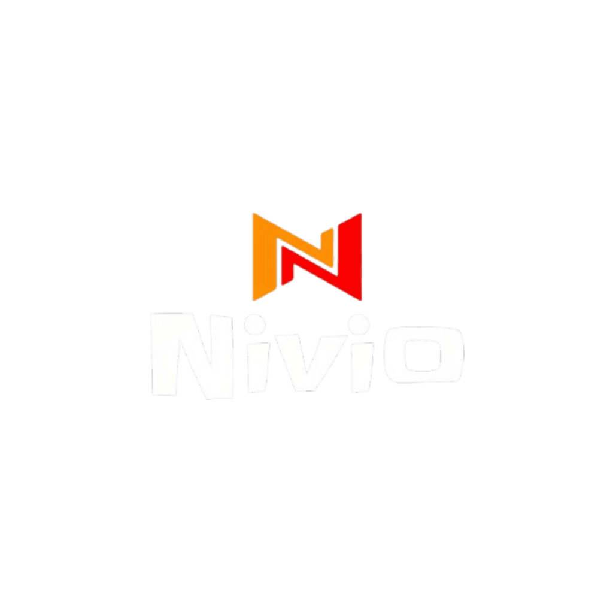

  **A beautiful, all-in-one streaming application for Movies, TV Shows, Anime, and Live IPTV, featuring Android and Linux desktop builds, real-time Watch Parties, and offline downloads.**

  [](https://flutter.dev/)
  [](https://firebase.google.com/)
  [](https://supabase.com/)
  [](https://opensource.org/licenses/MIT)

</div>

---

## 📸 Screenshots

### Android

<div align="center">
  <table border="0">
    <tr>
      <td align="center">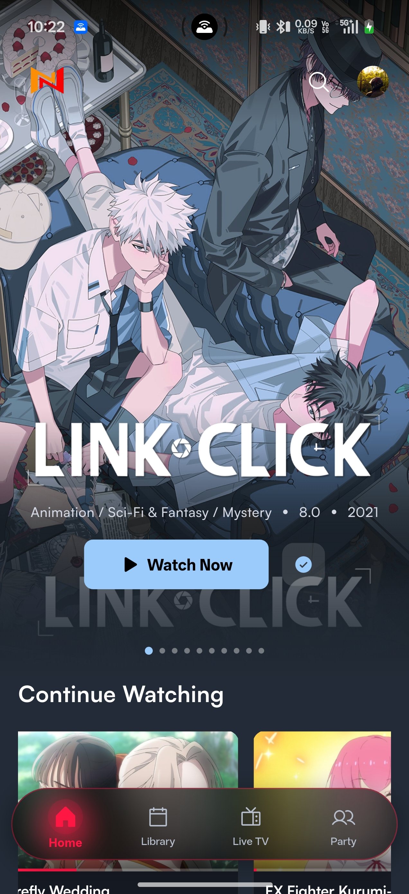<br><b>Home Screen</b></td>
      <td align="center"><br><b>Media Details</b></td>
      <td align="center"><br><b>Select Provider</b></td>
    </tr>
  </table>
  <table border="0">
    <tr>
      <td align="center"><br><b>Watch Party</b></td>
      <td align="center">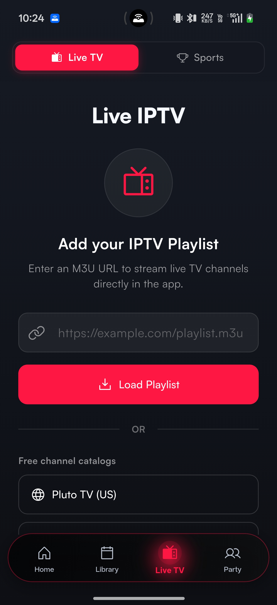<br><b>Live TV</b></td>
      <td align="center">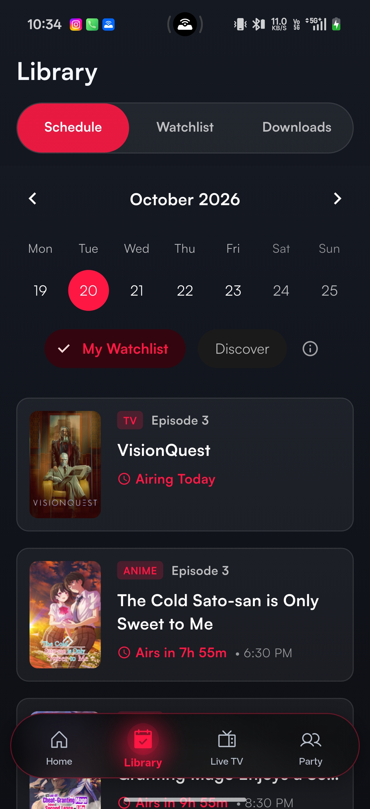<br><b>Your Library</b></td>
      <td align="center"><br><b>Settings</b></td>
    </tr>
  </table>
  <table border="0">
    <tr>
      <td align="center"><br><b>Video Player</b></td>
    </tr>
  </table>
</div>

### Linux Desktop

<div align="center">
  <table border="0">
    <tr>
      <td align="center">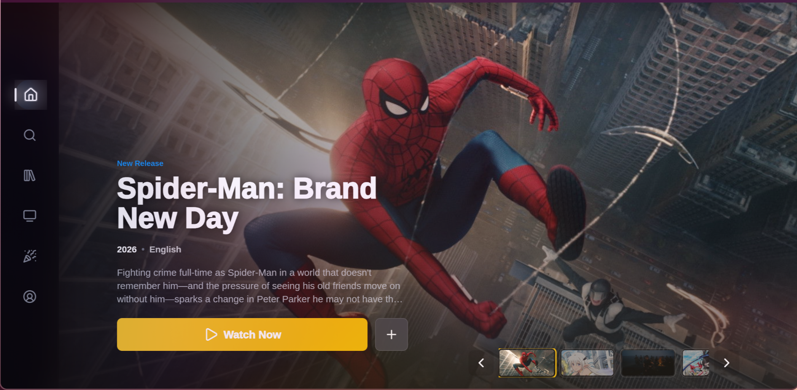<br><b>Desktop Home</b></td>
      <td align="center">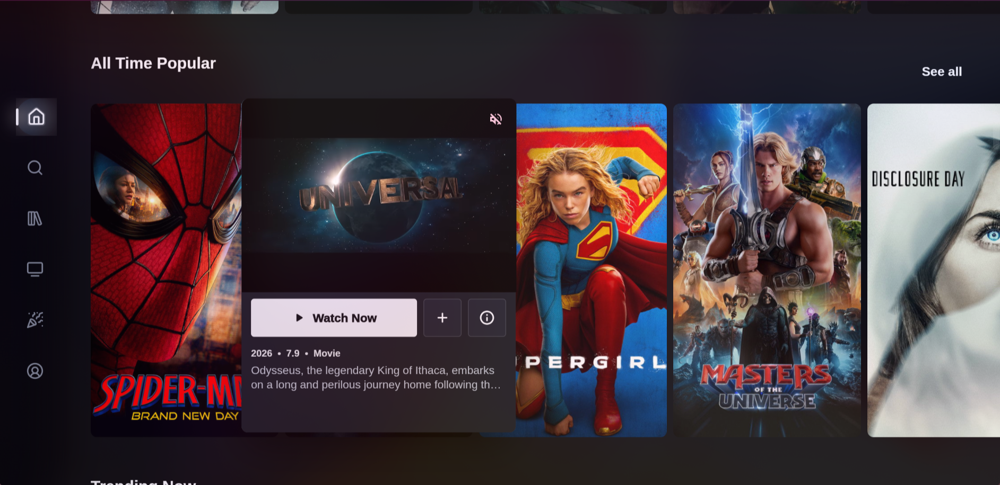<br><b>Hover Preview</b></td>
      <td align="center">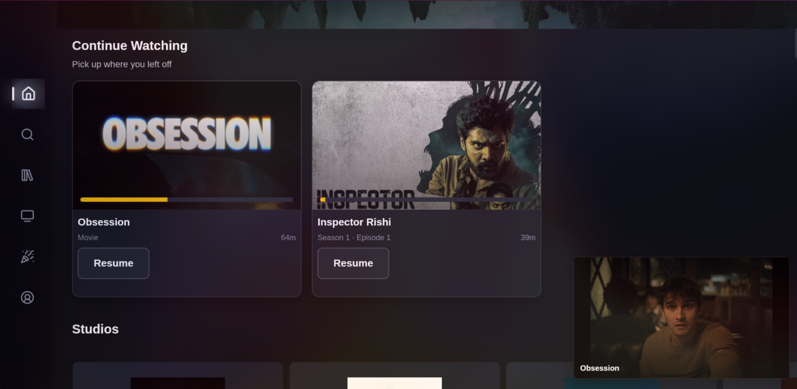<br><b>Mini Player</b></td>
    </tr>
  </table>
  <table border="0">
    <tr>
      <td align="center">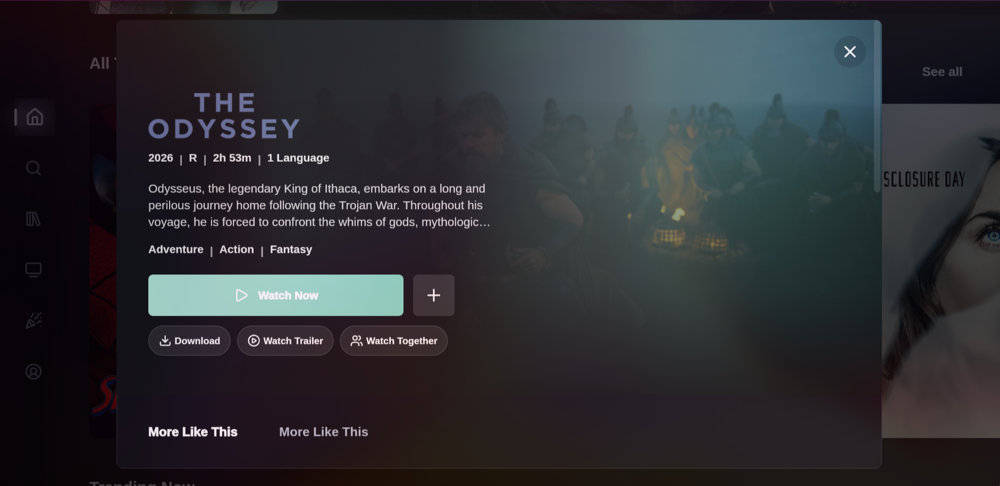<br><b>Details</b></td>
      <td align="center">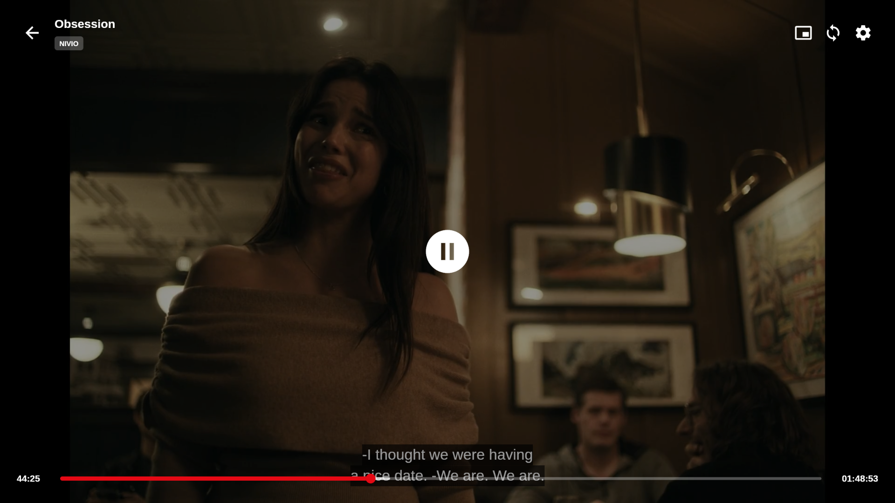<br><b>Player</b></td>
      <td align="center">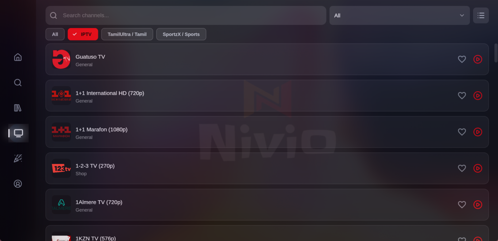<br><b>Live TV</b></td>
    </tr>
  </table>
  <table border="0">
    <tr>
      <td align="center">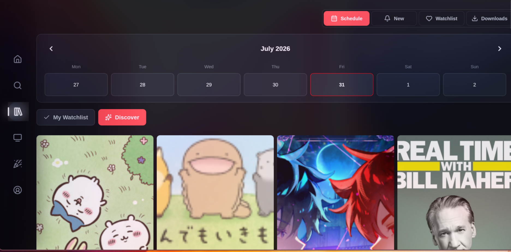<br><b>Library</b></td>
      <td align="center">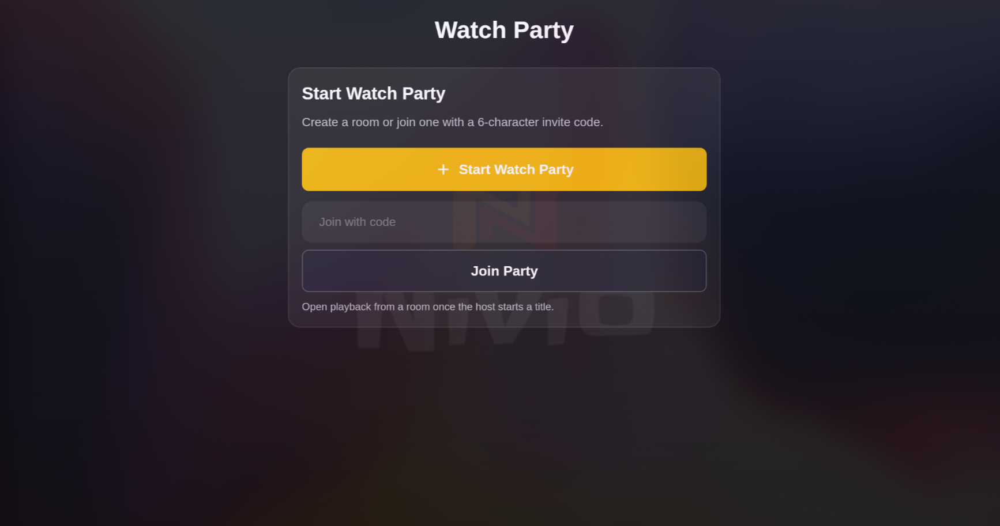<br><b>Watch Party</b></td>
    </tr>
  </table>
</div>

---

## 🚀 Features

### Core App Features

*   **🎬 Unified Discovery**: Browse trending Movies, TV Shows, and Anime directly from TMDB. Includes dedicated sections for regional content (Tamil, Telugu, Hindi, Korean).
*   **🎌 Dedicated Anime Hub**: Integrated with **AniList** for dedicated Anime scraping from high-speed providers (`Animetsu`, `Animex`, `Miruro`), complete with Miruro Cloudflare bypass and custom quality selection.
*   **🧠 Smart Recommendations**: An intelligent, privacy-first engine that analyzes your local watch history to curate a highly personalized "Top Picks For You" list by interleaving recommendations from your top 5 most recently watched titles.
*   **⚡ Blazing Fast Playback**: Custom native playback powered by `media_kit` and MPV/libmpv, with custom controls and platform-specific playback enhancements.
*   **🔊 Loudness Enhancer (Volume Boost)**: Supports software volume boost up to 200% for quieter streams and devices.
*   **📂 Custom Subtitles & Persistence**: Load subtitle files (.srt, .vtt) locally or paste remote URLs directly. Subtitle choices and styling preferences are saved for repeat playback.
*   **📡 Live IPTV**: Stream live television channels using M3U/M3U8 playlists and built-in live TV sources.
*   **🎉 Real-Time Watch Parties**: Create a room, share a 6-digit code, and watch movies perfectly synced with your friends. Host playback controls are synchronized across all devices instantly via Supabase.
*   **⬇️ Offline Downloads**: Download your favorite episodes for offline viewing.
*   **🚀 Updates**: Android supports Shorebird OTA updates; desktop includes release/update checks for Linux builds.
*   **💾 Cloud Sync & History**: Sign in with Google or anonymously. Watch progress, history, settings, and watchlists can sync across configured devices.
*   **🔔 Episode Alerts**: Track watchlist shows and check for newly aired episodes.
*   **🎛️ Total Control**: Change playback speeds, select custom audio tracks, customize subtitle styling, and tweak default video resolutions globally.

### Android Features

*   **🔊 Gesture Volume Boost**: Control the 200% loudness enhancer with screen swipes or TV arrow keys.
*   **📱 Mobile & TV Controls**: Gesture controls, D-pad friendly playback controls, Android PiP behavior, and Android background notification support.
*   **🚀 Shorebird OTA**: Receive over-the-air Android app updates without downloading a new APK.

### Linux Desktop Features

*   **🖥️ Desktop-first UI**: Sidebar navigation, wide-screen layouts, hover previews, keyboard-aware controls, and Linux window integration.
*   **🪟 Mini Player**: Keep playback visible while browsing other sections.
*   **🔊 200% Desktop Volume**: MPV-backed volume boost up to 200% with on-screen volume feedback.
*   **⏭️ Skip Intro / Outro**: Uses skip-time metadata where available to jump over intro and ending segments.
*   **🧩 Provider Fallbacks**: Resolves streams through multiple providers and falls back when a source fails.
*   **💬 Custom Subtitles**: Load local subtitle files or remote subtitle URLs.
*   **🌐 Embedded Web Fallback**: Uses WebKitGTK when a provider requires embedded playback.
*   **📺 Live TV Filters**: Supports custom playlists, favorites, source filters, and built-in live TV providers.
*   **📚 Desktop Library**: Continue Watching, watchlist, downloads, schedule, release timeline, and new episode panels.
*   **👤 Profile & Settings**: Cloud sync controls, playback settings, subtitle appearance, download storage, cache cleanup, content feed controls, and update checks.
*   **📦 Linux Packages**: AppImage, `.deb`, Arch package, and prepared Flatpak manifest.

---

## 🛠️ Tech Stack

*   **Frontend**: Flutter (Dart `^3.10.0`)
*   **State Management**: Riverpod
*   **Routing**: GoRouter
*   **Backend & Auth**: Firebase (Auth, Firestore)
*   **Realtime Sockets**: Supabase (For Watch Parties)
*   **Local Storage**: Hive & SharedPreferences
*   **Media Playback**: `media_kit` (high-performance playback engine utilizing `libmpv` / MPV for hardware-accelerated rendering and extensive format decoding)
*   **Linux Desktop**: Flutter Linux, WebKitGTK, GTK3, AppImage, Debian package, Arch package

---

## ⚙️ Installation & Setup

### Linux Desktop Downloads

Linux desktop builds are available from the
[Nivio Desktop 1.0.0 release](https://github.com/NithishSaravananRss/Nivio/releases/tag/desktop-v1.0.0).

Normal users should download one of the package files below, not the source
code archives:

| System | File | Install |
| --- | --- | --- |
| Portable Linux | `Nivio-x86_64.AppImage` | `chmod +x Nivio-x86_64.AppImage && ./Nivio-x86_64.AppImage` |
| Ubuntu, Debian, Linux Mint, Kali | `nivio-desktop_1.0.0_amd64.deb` | `sudo apt install ./nivio-desktop_1.0.0_amd64.deb` |
| Arch, Omarchy, Manjaro, EndeavourOS | `nivio-desktop-1.0.0-1-x86_64.pkg.tar.zst` | `sudo pacman -U ./nivio-desktop-1.0.0-1-x86_64.pkg.tar.zst` |

The desktop app source lives in `nivio_desktop/`.

### 1. Prerequisites
*   Flutter SDK (`^3.10.0`)
*   A free [Firebase](https://firebase.google.com/) Project
*   A free [TMDB](https://www.themoviedb.org/) API Key
*   *(Optional)* A free [Supabase](https://supabase.com/) Project for Watch Parties

### 2. Clone & Install
```bash
git clone https://github.com/yourusername/nivio.git
cd nivio
flutter pub get
```

### 3. Firebase Setup (Required)
You must connect the app to your own Firebase project for Auth and Database syncing.
1. Create a Firebase project.
2. Enable **Authentication** (Google & Anonymous).
3. Enable **Cloud Firestore**.
4. Use the FlutterFire CLI to configure your app:
   ```bash
   flutterfire configure
   ```
   *(This will generate the required `lib/firebase_options.dart` and native config files).*

### 4. TMDB API Key (Required)
Open `lib/core/constants.dart` and replace the `tmdbApiKey` variable with your own v3 API key:
```dart
const String tmdbApiKey = 'YOUR_TMDB_API_KEY_HERE';
```

### 5. Environment Variables Setup (Optional)
If you want to use the Watch Party feature, custom deep link sharing, or GitHub sponsors, create a `.env` file in the root of the project:
```env
# Supabase Configuration for Watch Parties
SUPABASE_URL=your_supabase_project_url
SUPABASE_ANON_KEY=your_supabase_anon_key

# Deep Link Configuration (URL where redirect.html is hosted)
SHARE_REDIRECT_URL=https://yourusername.github.io/Nivio/redirect.html

# Sponsor Configuration
GITHUB_SPONSOR_URL=https://github.com/sponsors/yourusername
```
*(If you skip this step, the app will still compile and run, but these features will either be disabled or use fallback placeholders).*

### 6. Run the App
```bash
flutter run
```

---

## 📦 Building for Release

To compile a highly-optimized release APK (with R8 minification configured for the video player):

```bash
flutter build apk --release
```

Or run the included bash script to build a Universal APK:
```bash
./build_universal_apk.sh
```

*(Note: Nivio also supports Shorebird for over-the-air (OTA) code pushes without requiring a full app update).*

---

## 🤝 Contributing

Contributions, issues, and feature requests are welcome! 
1. Fork the project.
2. Create your feature branch (`git checkout -b feature/AmazingFeature`).
3. Commit your changes (`git commit -m 'Add some AmazingFeature'`).
4. Push to the branch (`git push origin feature/AmazingFeature`).
5. Open a Pull Request.

Please make sure you run `flutter analyze` before opening a PR to ensure code quality!

---

## ❤️ Acknowledgements

Thank you to **Nirmaleeswar**, who started the Android version that Nivio builds from.

A massive thank you to the creators of [NetMirror-Extension](https://github.com/Sushan64/NetMirror-Extension) for their incredible work. Their repository was a huge inspiration and help in building some of the core scraping and provider logic for this app!

---

## 📜 License

Distributed under the MIT License. See `LICENSE` for more information.

---

## ⚠️ Disclaimer - DMCA

**Nivio does not host any media content.** 
This application acts strictly as an aggregator, scraping metadata and streaming links from publicly available third-party sources on the internet. The developers of Nivio are not affiliated with these sources. You are solely responsible for complying with your local laws, platform terms of service, and digital content rights policies when using this application.
