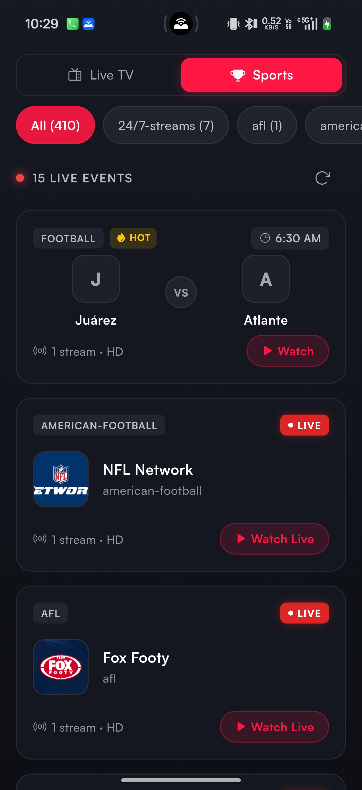
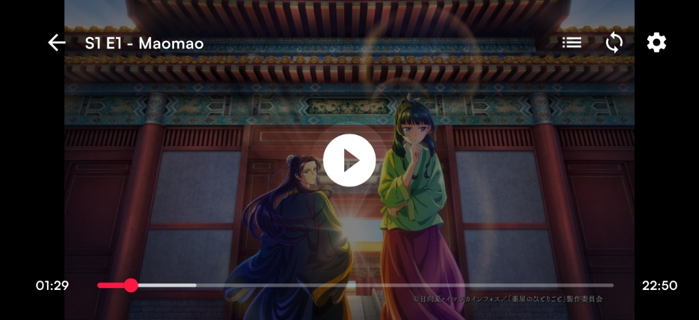
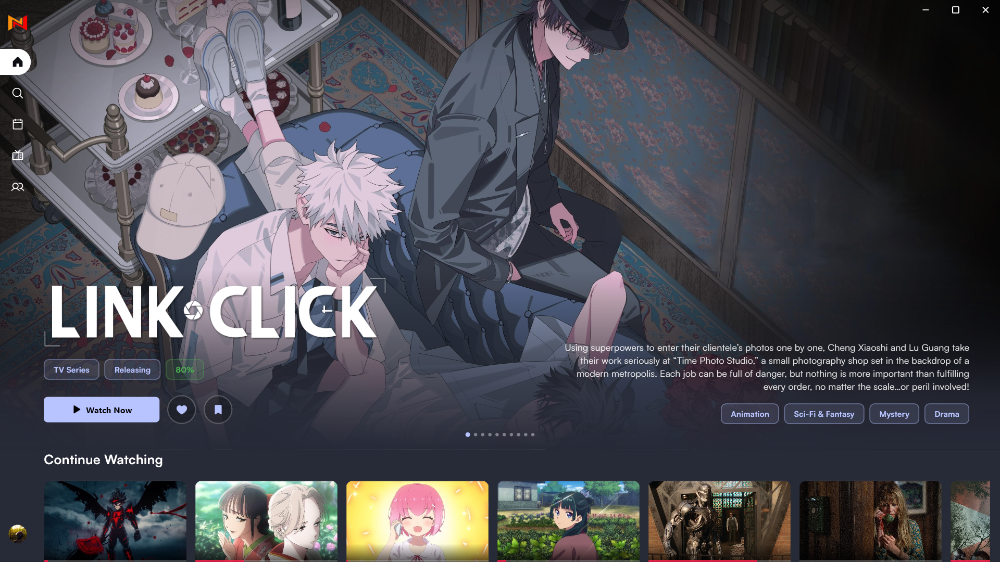
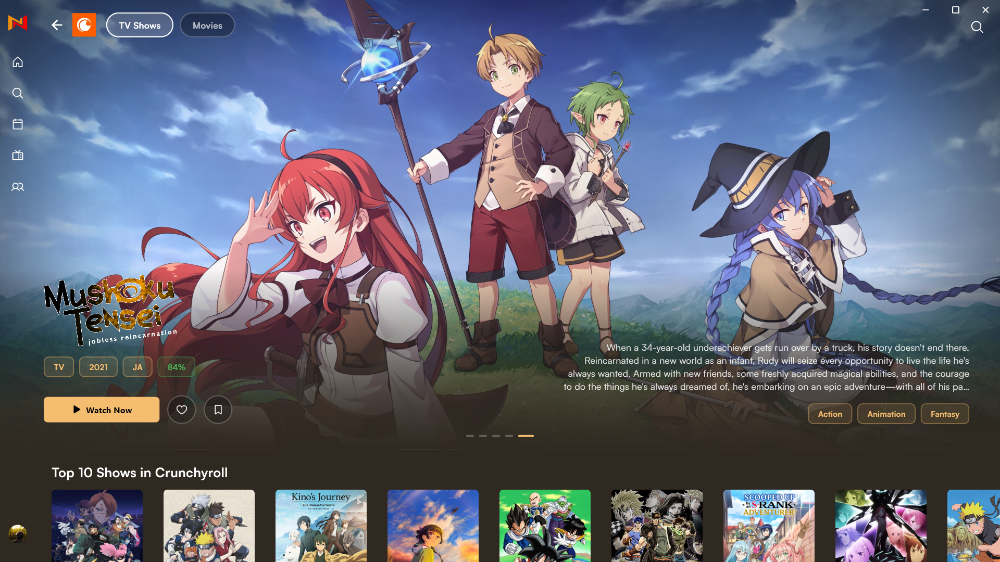
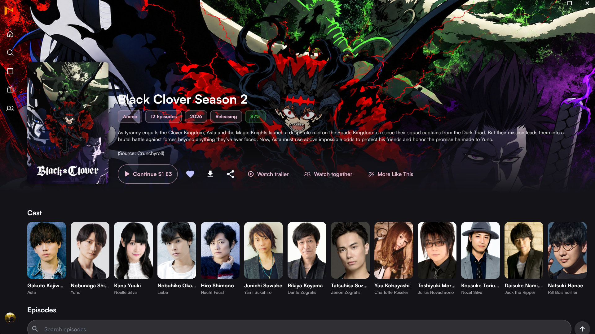
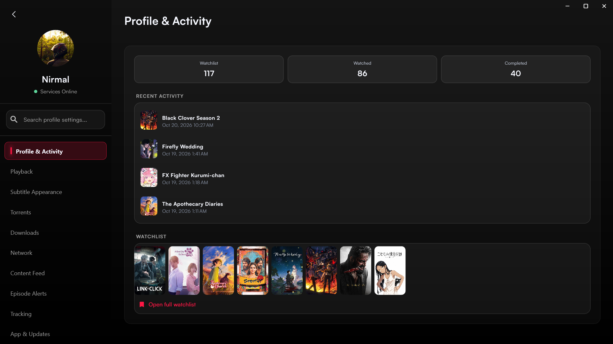
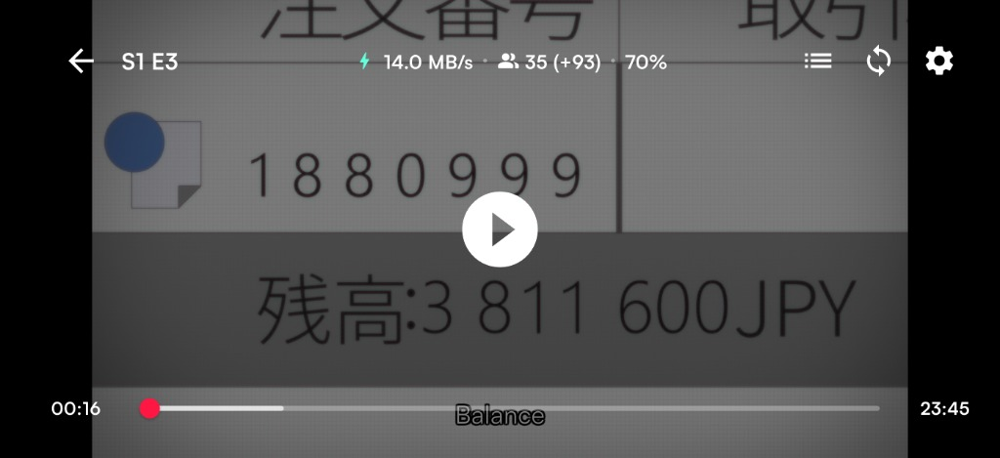

<div align="center">
  

  **A beautiful, all-in-one streaming application for Movies, TV Shows, Anime, and Live IPTV, featuring real-time Watch Parties and offline downloads.**

  [](https://flutter.dev/)
  [](https://www.rust-lang.org/)
  [](https://mpv.io/)
  [](https://firebase.google.com/)
  [](https://supabase.com/)

  [](https://www.themoviedb.org/)
  [](https://anilist.co/)
  [](https://github.com)
  [](https://opensource.org/licenses/MIT)

</div>

---

## ⚠️ Disclaimer - DMCA

> [!IMPORTANT]
> **Nivio does not host any media content.**  
> This application acts strictly as an aggregator, scraping metadata and streaming links from publicly available third-party sources on the internet. The developers of Nivio are not affiliated with these sources. You are solely responsible for complying with your local laws, platform terms of service, and digital content rights policies when using this application.

---

## 📸 Screenshots


<div align="center">

  <h3>📱 Mobile Edition</h3>

  <table border="0">
    <tr>
      <td align="center"><br><b>Home Screen</b></td>
      <td align="center"><br><b>Media Details</b></td>
      <td align="center"><br><b>Select Provider</b></td>
      <td align="center"><br><b>Watch Party</b></td>
    </tr>
    <tr>
      <td align="center"><br><b>Live TV</b></td>
      <td align="center"><br><b>Sports TV</b></td>
      <td align="center"><br><b>Your Library</b></td>
      <td align="center"><br><b>Settings</b></td>
    </tr>
  </table>
  <br>
  <table border="0">
    <tr>
      <td align="center"><br><b>Cinema Player</b></td>
    </tr>
  </table>

  <br><br>

  <h3>🖥️ Desktop Edition</h3>

  <table border="0">
    <tr>
      <td align="center"><br><b>Home Dashboard</b></td>
      <td align="center"><br><b>Stream Providers</b></td>
    </tr>
    <tr>
      <td align="center"><br><b>Media Details &amp; Cast</b></td>
      <td align="center"><br><b>Settings &amp; Preferences</b></td>
    </tr>
    <tr>
      <td align="center"><br><b>Cinema Player Engine</b></td>
      <td align="center"><br><b>BitTorrent Streaming Engine</b></td>
    </tr>
  </table>

</div>

---

## ✨ Highlights

* **🎉 Real-Time Watch Parties** — Stream together with friends in perfect sync, with shared playback controls.
* **🧲 Instant Torrent Streaming** — Watch magnet links directly on the fly without waiting for downloads, powered by an embedded Rust engine.
* **🎌 Dedicated Anime Hub** — Fast multi-source scraping, one-tap skip intro, filler episode tagging, and AniList sync.
* **⚽ Live Sports & IPTV** — Live sports match streams, schedules, and global TV channels.
* **⚡ Native MPV Playback** — Hardware-accelerated decoding, 200% software volume boost, and Picture-in-Picture.
* **🧠 Smart Recommendations** — Private, local recommendations shaped around what you actually watch.

---

## 💖 Support Nivio

Nivio is free and open source. If it makes your day a little better, consider supporting development — it keeps the project alive and actively maintained.

<div align="center">
  <a href="https://github.com/sponsors/nirmaleeswar30">
    
  </a>

  <br><br>
  <b>— or scan to pay via UPI —</b>
  <br><br>

  
</div>

---

## 🚀 Features

* **Two-Way Scrobbling & Tracking** (Simkl, AniList, MyAnimeList)
* **Cloud Sync & Watch History** (Google Sign-In / Firebase)
* **Offline Downloads**
* **Curated Release Shelves** (Theatrical, OTT Premiere & Weekly Anime)
* **Custom Subtitles & Persistence** (Local .srt/.vtt or remote URLs)
* **Native Desktop & Mobile Apps** (Windows, Linux, Android)
* **Background Episode Alerts**
* **Over-the-Air App Updates** (Shorebird CodePush)

---

## 🛠️ Tech Stack

*   **Architecture**: Modular Monorepo (`nivio_core`, `nivio_desktop`, `nivio_mobile`, `rqbit_ffi`)
*   **UI & Framework**: Flutter (Dart `^3.10.0`)
*   **Native P2P Engine**: Rust (`rqbit_ffi` / C-FFI bindings)
*   **Media Playback**: `media_kit` (high-performance playback engine utilizing `libmpv` / MPV for hardware-accelerated rendering and extensive format decoding)
*   **State Management**: Riverpod (`flutter_riverpod ^2.6.1`)
*   **Networking**: Dio & Google Cronet HTTP engine
*   **Routing & Navigation**: GoRouter (`go_router ^17.3.0`)
*   **Backend & Authentication**: Firebase (Firebase Auth, Cloud Firestore)
*   **Realtime Sockets**: Supabase (WebSockets for synchronized Watch Parties)
*   **Local Storage**: Hive & SharedPreferences
*   **Social & Presence**: Discord Rich Presence (RPC)
*   **Metadata & Tracking APIs**: TMDB, AniList (GraphQL), Simkl, MyAnimeList
*   **Background Tasks**: WorkManager & Local Notifications
*   **Over-the-Air Updates**: Shorebird CodePush

---

## ⚙️ Installation & Setup

### 1. Prerequisites
*   Flutter SDK (`^3.10.0`)
*   A free [Firebase](https://firebase.google.com/) Project
*   A free [TMDB](https://www.themoviedb.org/) API Key
*   *(Optional)* A free [Supabase](https://supabase.com/) Project for Watch Parties

### 2. Clone & Install
```bash
git clone https://github.com/yourusername/nivio.git
cd nivio
flutter pub get
```

### 3. Firebase Setup (Required)
You must connect the app to your own Firebase project for Auth and Database syncing.
1. Create a Firebase project.
2. Enable **Authentication** (Google & Anonymous).
3. Enable **Cloud Firestore**.
4. Use the FlutterFire CLI to configure your app:
   ```bash
   flutterfire configure
   ```
   *(This will generate the required `lib/firebase_options.dart` and native config files).*

### 4. TMDB API Key (Required)
Open `lib/core/constants.dart` and replace the `tmdbApiKey` variable with your own v3 API key:
```dart
const String tmdbApiKey = 'YOUR_TMDB_API_KEY_HERE';
```

### 5. Environment Variables Setup (Optional)
If you want to use the Watch Party feature, custom deep link sharing, or GitHub sponsors, create a `.env` file in the root of the project:
```env
# Supabase Configuration for Watch Parties
SUPABASE_URL=your_supabase_project_url
SUPABASE_ANON_KEY=your_supabase_anon_key

# Deep Link Configuration (URL where redirect.html is hosted)
SHARE_REDIRECT_URL=https://yourusername.github.io/Nivio/redirect.html

# Sponsor Configuration
GITHUB_SPONSOR_URL=https://github.com/sponsors/yourusername
```
*(If you skip this step, the app will still compile and run, but these features will either be disabled or use fallback placeholders).*

### 6. Run the App
```bash
flutter run
```

---

## 📦 Building for Release

To compile a highly-optimized release APK (with R8 minification configured for the video player):

```bash
flutter build apk --release
```

Or run the included bash script to build a Universal APK:
```bash
./build_universal_apk.sh
```

*(Note: Nivio also supports Shorebird for over-the-air (OTA) code pushes without requiring a full app update).*

### 🖥️ Windows Desktop (installer)

> **Important:** the Windows app **must** be built from `packages/nivio_desktop`, **not** the repo root. The desktop package swaps `google_sign_in` / `firebase_*` for local stubs (browser‑OAuth loopback login that works on Windows); the root build uses the real `google_sign_in`, which has no Windows implementation and fails at runtime with `UnimplementedError`.

Build the release and package the installer in one step:
```bash
./scripts/build_windows_installer.sh
```

Or run the steps manually:
```bash
# 1. Build the desktop app (from the desktop package, not root)
cd packages/nivio_desktop && flutter build windows --release && cd ../..

# 2. Compile the Inno Setup installer (needs Inno Setup 6 / ISCC.exe)
"$LOCALAPPDATA/Programs/Inno Setup 6/ISCC.exe" installer/nivio.iss
```
The installer is written to `dist/Nivio-<version>-windows-x64-setup.exe`.

---

## 🤝 Contributing

Contributions, issues, and feature requests are welcome! 
1. Fork the project.
2. Create your feature branch (`git checkout -b feature/AmazingFeature`).
3. Commit your changes (`git commit -m 'Add some AmazingFeature'`).
4. Push to the branch (`git push origin feature/AmazingFeature`).
5. Open a Pull Request.

Please make sure you run `flutter analyze` before opening a PR to ensure code quality!

---

## ❤️ Acknowledgements

* **[Hayase](https://github.com/hayase-app)** — Inspiration for the P2P torrent streaming experience.

---

## ⭐ Star History

<a href="https://star-history.com/#nirmaleeswar30/Nivio&Date">
 <picture>
   <source media="(prefers-color-scheme: dark)" srcset="https://api.star-history.com/svg?repos=nirmaleeswar30/Nivio&type=Date&theme=dark" />
   <source media="(prefers-color-scheme: light)" srcset="https://api.star-history.com/svg?repos=nirmaleeswar30/Nivio&type=Date" />
   
 </picture>
</a>

---

## 📜 License

Distributed under the MIT License. See `LICENSE` for more information.
